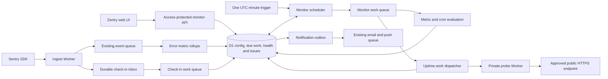

# Sentry-style monitoring on Cloudflare Workers

**Implementation plan for Zentry · 18 November 2026**

Build a single Monitors area for **Metric**, **Cron**, and **Uptime**. A monitor evaluates a signal and maintains a health history. It opens, updates, and resolves an issue when that signal warrants attention. An alert decides who hears about an issue change and how often. Defer Mobile Build monitoring. This plan supersedes the exclusions for cron and metrics in the original [Zentry design](../DESIGN.md#2-scope).

Start with a shared monitor lifecycle and an error-count metric, then ship SDK cron check-ins and uptime for approved public endpoints. Expand metric sources and detection modes once the underlying telemetry can support them. The first release should include the three monitor types, self-service configuration within the supported limits, useful history, links to issues, and email and mobile push through Zentry’s existing delivery system.

## 1. What Sentry actually does

This review uses the [Sentry source snapshot from 18 November](https://github.com/getsentry/sentry/commit/4e62bf96aeed70fb932b4338367e8d12d0d87022), the [uptime-checker snapshot from 17 November](https://github.com/getsentry/uptime-checker/commit/6c89869c8a58b74be45a61aec0459d2345730bcc), the [SDK check-in specification](https://develop.sentry.dev/sdk/telemetry/check-ins/) and [Relay’s check-in publisher](https://github.com/getsentry/relay/blob/cdfbe1981b9f8c8e9b440e8ad432deed2f34e037/relay-server/src/services/store.rs). Public API documentation is a useful reference for config shapes. It documents metric creation on the unified endpoint, while the product source also has dedicated builders and type-specific validators for Cron and Uptime. [Project monitor API](https://docs.sentry.io/api/monitors/create-a-monitor-for-a-project/) · [Detector type picker](https://github.com/getsentry/sentry/blob/4e62bf96aeed70fb932b4338367e8d12d0d87022/static/app/views/detectors/components/detectorTypeForm.tsx)

The picker offers metric, cron, uptime, and a feature-gated mobile build type. Sentry-created error monitors are a separate case. Its workflow engine models a project detector, typed data sources, condition groups, owner, enabled state and linked workflows. The newer workflow connects monitors to reusable issue alerts. Multiple IF/THEN blocks and throttling are existing Sentry capabilities. That split is worth adopting even with a simpler v1 alert editor. [Detector model](https://github.com/getsentry/sentry/blob/4e62bf96aeed70fb932b4338367e8d12d0d87022/src/sentry/workflow_engine/models/detector.py) · [Detector validation](https://github.com/getsentry/sentry/blob/4e62bf96aeed70fb932b4338367e8d12d0d87022/src/sentry/workflow_engine/endpoints/validators/base/detector.py) · [Monitor and alert architecture discussion](https://github.com/getsentry/sentry/discussions/101960)

| Type   | Upstream execution path                                                                                                                                                                                                                             | Behavior to bring to Zentry                                                                                                                                     |
| ------ | --------------------------------------------------------------------------------------------------------------------------------------------------------------------------------------------------------------------------------------------------- | --------------------------------------------------------------------------------------------------------------------------------------------------------------- |
| Metric | The builder turns a dataset, aggregate or equation, filter, environment and time window into a subscription-backed data source. Subscription updates go through a metric detector, conditions and issue processing.                                 | Preview and evaluate the same query. Support priority and recovery thresholds. Store the triggering value, scope and window with the issue.                     |
| Cron   | An SDK emits a `check_in` item. Relay publishes it to Sentry’s monitors stream. Sentry tracks check-ins and expected schedules per monitor environment. Clock tasks find missing and timed-out runs. Failure and success streaks control incidents. | Accept real SDK messages, report explicit failures and missed/overlong runs, and show scheduled versus received times by environment.                           |
| Uptime | Sentry saves a subscription for a separate Rust checker. The checker schedules URL requests, handles bounded attempts, evaluates HTTP results and assertions, and emits results. Sentry owns the downstream issue decision and region policy.       | Make the request independently of application telemetry. Record attempts separately from the final scheduled result. Confirm sustained failures and recoveries. |

[Metric builder](https://github.com/getsentry/sentry/blob/4e62bf96aeed70fb932b4338367e8d12d0d87022/static/app/views/detectors/components/forms/metric/metric.tsx) · [Metric detector](https://github.com/getsentry/sentry/blob/4e62bf96aeed70fb932b4338367e8d12d0d87022/src/sentry/incidents/metric_issue_detector.py) · [Cron models](https://github.com/getsentry/sentry/blob/4e62bf96aeed70fb932b4338367e8d12d0d87022/src/sentry/monitors/models.py) · [Cron clock dispatch](https://github.com/getsentry/sentry/blob/4e62bf96aeed70fb932b4338367e8d12d0d87022/src/sentry/monitors/clock_dispatch.py) · [Uptime subscriptions](https://github.com/getsentry/sentry/blob/4e62bf96aeed70fb932b4338367e8d12d0d87022/src/sentry/uptime/subscriptions/subscriptions.py) · [Uptime checker scheduler](https://github.com/getsentry/uptime-checker/blob/6c89869c8a58b74be45a61aec0459d2345730bcc/src/scheduler.rs) · [Uptime execution and retries](https://github.com/getsentry/uptime-checker/blob/6c89869c8a58b74be45a61aec0459d2345730bcc/src/check_executor.rs)

Use these sources as a behavioral reference and implement the feature in Zentry’s TypeScript and SQL. The pinned Sentry and uptime-checker repositories use FSL-1.1-Apache-2.0, with a competing-use clause and an Apache 2.0 grant that takes effect two years after a version is made available. Review the specific license before incorporating code from any upstream component. Build the screens with Zentry’s own components and layout. [Pinned Sentry license](https://github.com/getsentry/sentry/blob/4e62bf96aeed70fb932b4338367e8d12d0d87022/LICENSE.md) · [Pinned uptime-checker license](https://github.com/getsentry/uptime-checker/blob/6c89869c8a58b74be45a61aec0459d2345730bcc/LICENSE.md)

## 2. Starting point in Zentry

| Existing code                                                                                                                                                        | Implication                                                                                                                                                                                                                                                      |
| -------------------------------------------------------------------------------------------------------------------------------------------------------------------- | ---------------------------------------------------------------------------------------------------------------------------------------------------------------------------------------------------------------------------------------------------------------- |
| [Worker entry point](../src/worker.ts) and [Wrangler config](../wrangler.jsonc)                                                                                      | Cloudflare Access protects web administration. SDK ingest and device API have their own access paths. There are existing event and notification queues plus three scheduled triggers. Add one minute trigger for monitor work and keep web writes behind Access. |
| [Envelope reader](../src/core/envelope.ts) and [ingest handler](../src/ingest/handler.ts)                                                                            | The parser reads multiple items but the handler routes only the first `event`. Check-in-only envelopes can return success without recording a check-in. Add explicit type dispatch using the existing parser and DSN-to-project authentication.                  |
| [Event planner](../src/core/plan.ts), [batch store](../src/db/batch.ts) and [initial schema](../migrations/0001_init.sql)                                            | R2 and the event index keep a bounded sample. Project and issue stats are hourly and based on receive time. Neither gives an exact five-minute, environment-filtered event count. Collect monitoring data before full-event sampling.                            |
| [API router](../src/api/router.ts), [context](../src/api/context.ts), and [issue store](../src/db/issues.ts)                                                         | Organization membership is resolved at the router. Follow the current route conventions and scope lookups by organization and project. Existing issues can host monitor incidents after adding a typed source and evidence view.                                 |
| [Outbox reader](../src/db/outbox.ts), [issue alerts](../src/notify/alerts.ts), [recipient selection](../src/notify/recipients.ts) and [sweep](../src/cron/notify.ts) | Reuse recipient preferences, suppressions, delivery bookkeeping, and queue wakeups. Add a typed monitor incident message and channel content. Existing issue alert jobs are keyed to error issue behavior and project digests.                                   |
| [React SPA](../ui/src/app.tsx), [route helpers](../ui/src/lib/router.ts) and [shared contract](../src/shared/contract.ts)                                            | Add Monitors to the existing SPA. Use the shared API types, chart primitives and route helpers. A new frontend framework adds no prerequisite for the feature.                                                                                                   |

Check these boundaries while implementing. Use pure transitions in `src/core/`, SQL in `src/db/`, input validation at the boundary, and binding assembly in `src/worker.ts`. If the isolated HTTP probe entry point adds a domain, update the allowed imports and design table together. [Import rules](../oxlint.config.ts) · [Repository layout](../README.md#layout)

## 3. Create and manage a monitor

The organization’s Monitors page should show name, type, project, environment where applicable, owner, recent health, last evaluation, action summary and active issue. Filter by project, type, health and owner. The create flow begins with the type and project, then asks for the type-specific signal, recovery criteria and notification routing. Edit uses the same fields. Each detail page shows the current configuration, last and next expected check, state timeline, evidence, incident links and configuration changes.

| Shared setting       | First release                                                                                                                                                                                                                                                             |
| -------------------- | ------------------------------------------------------------------------------------------------------------------------------------------------------------------------------------------------------------------------------------------------------------------------- |
| Project and name     | Project required. Name required, with a suggested name from the selected signal. Type and project fixed after creation. Cron gets an independent stable slug for SDKs.                                                                                                    |
| Description          | Optional runbook context such as what a failure means, who owns the service and how to investigate. Render any Markdown through the existing sanitizer.                                                                                                                   |
| Environment          | Metric chooses all or one. Cron accepts configured environments and tracks them separately. Uptime binds an optional environment label to one endpoint. Display exact scope in previews and alerts.                                                                       |
| Owner                | Optional organization member with visibility of the project. Ownership supplies routing context. Store the association separately from notification preferences.                                                                                                          |
| Monitoring status    | Active, paused, archived. A paused monitor schedules no new evaluations and pages nobody. Resume starts from a fresh schedule and streak. Archive keeps history for its retention period and releases scheduling capacity.                                                |
| Mute and maintenance | Mute suppresses delivery while recording real health transitions. Start with immediate mute and an optional expiry. Add one-off and recurring maintenance windows after validating pause/resume semantics. Show history and current state when muted.                     |
| Linked alerts        | Default to no recipients until selected. Allow an existing alert or a simple rule created inline with failure, escalation and optional recovery actions. Support per-rule throttling and channel preferences.                                                             |
| Preview              | Metric chart and threshold replay, Cron next occurrences and SDK instructions, Uptime test request with sanitized diagnostics. Preview runs do not update live health, alter streaks or produce issue notifications. Apply the same permissions and budgets as live work. |

Keep configuration status, health, and notification suppression as separate fields. Show `Awaiting data`, `Healthy`, `Degraded`, `Failing`, and `Unknown` where meaningful, with a specific reason. Examples include a new cron awaiting its first check-in, a delayed metric input stream, and a failed URL request. Report who changed settings and when. Redact request secrets in the UI, audit log, API response and copied monitor settings.

### Settings coverage by type

| Type   | Sentry settings and variants                                                                                                                                                                                        | Zentry first release                                                                                                                                                                                                                  | Expansion                                                                                                                                                                                           |
| ------ | ------------------------------------------------------------------------------------------------------------------------------------------------------------------------------------------------------------------- | ------------------------------------------------------------------------------------------------------------------------------------------------------------------------------------------------------------------------------------- | --------------------------------------------------------------------------------------------------------------------------------------------------------------------------------------------------- |
| Metric | Dataset/templates, environment, query, aggregation or metric equation, time window, operators/priority, threshold/change/dynamic detection, resolution strategy, issue owner and linked alerts.                     | Error-event count, exact environment and level filters, 5/15/60-minute windows, above/below comparisons, high and optional lower-priority thresholds, explicit recovery, minimum samples for value sources when added, chart preview. | Percent change, SDK counters and gauges, bounded equations, distributions/percentiles, new telemetry sources and calibrated anomaly detection.                                                      |
| Cron   | Crontab or interval, timezone, grace margin, expected runtime, failures to open, successes to recover, environment pause/mute behavior, instrumentation, ownership and alerts.                                      | Crontab and interval, all timing and streak inputs, environment policy, one-shot and paired SDK check-ins, next-occurrence preview and test instructions.                                                                             | Trusted SDK provisioning, environment-level maintenance, richer check-in diagnostics and migration tooling if needed.                                                                               |
| Uptime | URL, request method/headers/body, frequency, timeout, region selection/scheduling, response assertions, failure/recovery thresholds, test request, owner and alerts. Some fields are gated in the upstream builder. | Exact approved public HTTPS hostname, GET/HEAD, 1/5/10/20/30/60 minutes, timeout, default 2xx or bounded explicit status codes, no redirects, test request, failure/recovery streaks and one observation source.                      | Verified self-service domains, encrypted header values, same-origin redirects, bounded content/header assertions, latency thresholds, regional redundancy and carefully gated body-bearing methods. |

[Metric settings and detection modes](https://github.com/getsentry/sentry/blob/4e62bf96aeed70fb932b4338367e8d12d0d87022/static/app/views/detectors/components/forms/metric/metric.tsx) · [Metric recovery form](https://github.com/getsentry/sentry/blob/4e62bf96aeed70fb932b4338367e8d12d0d87022/static/app/views/detectors/components/forms/metric/resolveSection.tsx) · [Cron settings serialization](https://github.com/getsentry/sentry/blob/4e62bf96aeed70fb932b4338367e8d12d0d87022/static/app/views/detectors/components/forms/cron/fields.tsx) · [Uptime form](https://github.com/getsentry/sentry/blob/4e62bf96aeed70fb932b4338367e8d12d0d87022/static/app/views/detectors/components/forms/uptime/detect/index.tsx) · [Uptime checker config](https://github.com/getsentry/uptime-checker/blob/6c89869c8a58b74be45a61aec0459d2345730bcc/src/types/check_config.rs)

## 4. Workers execution and storage

Keep configuration, scheduling and incident state in the existing D1 database initially. That lets Zentry commit health transitions, issue mutations and notification intent in one transaction. Use a separate monitor workload queue with a DLQ for scheduled work, a dedicated check-in queue with its own DLQ, and a private service binding for the probe Worker. Give the probe only the bindings it needs for HTTPS execution. If slow probes delay cron or metric evaluation in the pilot, give probes a dedicated workload queue and concurrency limit before opening the pilot further. [D1 batch transactions](https://developers.cloudflare.com/d1/worker-api/d1-database/#batch) · [Queues delivery guarantees](https://developers.cloudflare.com/queues/reference/delivery-guarantees/) · [Service bindings](https://developers.cloudflare.com/workers/runtime-apis/bindings/service-bindings/)

### Durable scheduling and ordering

1. Add a single `* * * * *` trigger. Pass `controller.scheduledTime` as the tick and use the actual clock for lease expiry. Scan indexed due rows ordered by `(due_at, id)` in bounded pages with a per-tenant work allowance. Assign stable phases to uptime intervals and budget work independently by type. Let the minute tick wake the dispatcher and let it process expired deadlines even if ticks are repeated or delayed. [Cron Triggers](https://developers.cloudflare.com/workers/configuration/cron-triggers/) · [Scheduled handler](https://developers.cloudflare.com/workers/runtime-apis/handlers/scheduled/)
2. In one D1 batch, materialize each logical job and advance its schedule cursor. Give the job a unique key containing monitor, revision, scope, kind and slot/deadline. Lease pending dispatch rows with an expiry and a token, send small ID-only queue messages and record dispatch. A crash between sending and marking can produce a duplicate. A crash before sending leaves a lease that expires. Completion must be valid if the consumer runs before the producer marks dispatch. Reconcile sent-but-stalled work and expired leases. The D1 job is the source of truth.
3. Consumers resolve a job ID to a current monitor revision and lease. Use an atomic claim with a fenced token. Commit effects only when that token and revision still match inside the write batch. Gate every dependent insert/update on the same eligibility, and write the completion marker last. Apply transitions in logical slot order per scope. For uptime, allow at most one live probe per scope and turn a superseded slot into `unknown` when its freshness deadline passes. A duplicate never moves a streak or sends a second incident transition.
4. Separate product failures from runtime failures. A verified target returned HTTP 503 is a result. Lost queue work, unavailable data, an egress configuration error, and an overloaded database are operational states. Retry transient runtime errors, keep durable diagnostics and use a DLQ. Replaying a job requires its original identity and freshness checks. A stale uptime slot is skipped, while metric catch-up may reconstruct recent history without sending delayed live notifications.
5. Pause, edits and archive change the scheduling revision or enabled state transactionally. Reset the streak when signal semantics change, and record why. Keep label/owner/alert changes as metadata updates so editing copy does not discard pending observations. Reject outputs from superseded revisions. When an active incident’s semantics change, close its open period with a configuration reason and suppress recovery delivery. Preview and live execution use separate identities.

### Proposed D1 records

| Record                                                  | Keys and purpose                                                                                                                                                                                                                                      |
| ------------------------------------------------------- | ----------------------------------------------------------------------------------------------------------------------------------------------------------------------------------------------------------------------------------------------------- |
| `monitors`, `monitor_revisions`                         | Project-scoped ID, type, status, owner, current immutable signal revision, optimistic edit version and sanitized audit data. Unique project/cron slug. Store validated typed config and put searchable/scheduled attributes in columns.               |
| `monitor_scopes`                                        | `(monitor_id, scope_key)`, indexed next deadline, generation, health, streaks, most recent observation and active incident. A metric or uptime monitor usually has one scope. Cron has one per tracked environment.                                   |
| `monitor_jobs`                                          | Unique logical job identity, due and expiry times, lease token/expiry, state, completion and retry count. Partial due/lease indexes and scheduled cleanup.                                                                                            |
| `monitor_observations`                                  | Unique logical observation per revision/scope/slot, status, evidence and evaluator/finalization times. Timeline index on monitor, scope and scheduled time. Keep secrets, response bodies and raw telemetry out of this record.                       |
| `cron_environments`, `cron_checkins` (as built)         | Pair check-ins by monitor, scope and SDK check-in ID. Record scheduled, started, completed and received times, runtime, terminal result and dedupe identity. Index pending runtime deadlines.                                                         |
| `metric_level_minutes`, receipts and pending inputs     | Key rollups by dataset, project, minute and bounded dimensions. Track input coverage as well as values. Dedupe identity lifetime must cover accepted ingest and queue replay horizons.                                                                |
| `monitor_incident_periods`, alert rules and alert links | Stable issue association per scope, open/close times and disposition, state transition ID, rule attachments and a unique notification intent per transition/rule/channel/recipient. Keep issue and transition evidence after detailed samples expire. |

Use foreign keys and tenant-scoped queries. Add explicit lifecycle handling for project deletion, including pending jobs and retained evidence. Start with 14 days of full observations, 7 days of job diagnostics and 90 days of hourly/daily summaries and incident periods, subject to load tests and the project’s data policy. Keep replay protection for the actual accepted replay horizon even where job diagnostics expire sooner. Use batched, indexed pruning. Count rows and index writes using D1 response metadata and check query plans before adding dimensions. D1’s paid per-database ceiling is 10 GB, and each database processes queries serially. [D1 limits](https://developers.cloudflare.com/d1/platform/limits/) · [D1 billing metrics](https://developers.cloudflare.com/d1/platform/pricing/)

## 5. Metric monitors

### Establish the first metric

Use **accepted error-event count**. Start with Zentry’s normalized error events, a single project, exact level/environment predicates and a documented receive-time basis. The aggregate measures events accepted by Zentry that qualify after normalization and have been processed. Label the preview “Error events received” and surface the date from which coverage exists. Sentry’s default form selects an error count and one-hour window, with an unresolved-issue filter. Zentry’s first metric uses the event attributes themselves. An unresolved-issue filter needs a defined join and a decision about issue status as of event time or evaluation time. [Sentry templates](https://github.com/getsentry/sentry/blob/4e62bf96aeed70fb932b4338367e8d12d0d87022/static/app/views/detectors/components/forms/metric/metricTemplateOptions.tsx) · [Form defaults and condition mapping](https://github.com/getsentry/sentry/blob/4e62bf96aeed70fb932b4338367e8d12d0d87022/static/app/views/detectors/components/forms/metric/metricFormData.tsx#L46-L290)

1. **Capture before sampling.** Write one bounded rollup contribution per normalized unique event, including duplicates across separate deliveries. The existing dedupe lookup reads stored event IDs, so events whose bodies were omitted can reappear on delivery. For monitored projects, use a short-lived receipt keyed by `(project_id, event_id)` independent of full-body retention. Insert facts and rollup deltas transactionally with event processing. Only a receipt newly claimed by that transaction may increment a bucket. Coalesce writes by project, minute, normalized environment and level. Bound dimensions and expose any policy that excludes or buckets new dimension values. [Zentry event planning](../src/core/plan.ts) · [Zentry event writes](../src/db/batch.ts)
2. **Pick a close policy with evidence.** Evaluate every minute over `[windowEnd - length, windowEnd)` after a proposed two-minute processing delay. Label the result as a count of processed input. Track source coverage from opt-in, current processing age, dropped/rejected input and observed backlog per source. For first-release paging, a window that predates coverage or overlaps a known ingest gap is `unknown`. A timer and queue depth give an operational signal about freshness. If the product needs proof that every acknowledged event made it into a closed window, implement an opt-in durable ingest ledger before ACK. Store pending receipt/batch IDs by accepted minute, clear them in the same commit as contribution writes, and close only when that minute is sealed and fully processed. Require that stronger path before enabling below-count alerts on absence alone. Load-test it on the normal ingest path first.
3. **Keep history and live decisions coherent.** If delayed input arrives after a window is finalized, allow the chart to display a corrected value alongside the original evaluation evidence. Recompute past windows as history only. A live incident is advanced by the next eligible window. Protect event IDs through the configured queue/redrive window and reject replays that predate receipt retention. Preview and live must share the query builder, units, filter and window alignment.
4. **Calculate state deterministically.** Use strict or inclusive comparators exposed in the builder. Validate the order of severity thresholds and recovery. Example for rising errors: medium at `>= 50`, high at `>= 100`, recovery at `< 40` in five minutes. The latest value 103 opens high, 65 downgrades to medium, 45 holds the previous severity, and 39 resolves. Only emit escalation when severity increases. Persist completed-window identity, value, window bounds, sample count, threshold and reason used for the decision. Sentry’s builder emits an explicit OK condition and its stateful detector applies conditions to ordered data packets. [Metric validator and subscription](https://github.com/getsentry/sentry/blob/4e62bf96aeed70fb932b4338367e8d12d0d87022/src/sentry/incidents/metric_issue_detector.py) · [Subscription processor](https://github.com/getsentry/sentry/blob/4e62bf96aeed70fb932b4338367e8d12d0d87022/src/sentry/incidents/subscription_processor.py#L50-L267) · [Stateful detector](https://github.com/getsentry/sentry/blob/4e62bf96aeed70fb932b4338367e8d12d0d87022/src/sentry/workflow_engine/handlers/detector/stateful.py#L353-L532)

Treat numeric zero, no data and processing failure as separate states. A count can be zero with established coverage. A gauge with no samples is unknown, and a rate with a zero denominator is undefined. Unknown leaves an open incident open, resets consecutive confirmation streaks, and appears on the timeline. Offer explicit no-data policies for value and heartbeat sources once there is a defined contract. One upstream aggregate helper maps a null subscription aggregate to zero, while some comparison paths can return no value. Zentry’s policy should be visible and consistent across preview and execution. [Upstream aggregation helper](https://github.com/getsentry/sentry/blob/4e62bf96aeed70fb932b4338367e8d12d0d87022/src/sentry/incidents/utils/process_update_helpers.py#L64-L152)

### Expand the metric surface in dependency order

| Expansion                                                 | Data and evaluation needed                                                                                                                                                                                                                                                                                                                                                        |
| --------------------------------------------------------- | --------------------------------------------------------------------------------------------------------------------------------------------------------------------------------------------------------------------------------------------------------------------------------------------------------------------------------------------------------------------------------- |
| Percentage change                                         | Compare equal windows at a selected offset. Start with 15 minutes, 1 hour, 1 day and 1 week if retained. Store both values and minimum sample counts. A missing or zero baseline produces insufficient evidence. Make the UI display increase/decrease in human terms. Sentry’s transport expresses the new value as a percentage of the baseline.                                |
| Application counters and gauges                           | Pick supported SDK versions and record real envelope fixtures. Route only the supported item shapes to a dedicated telemetry queue. Enforce types, units, label allowlists, per-project series caps and timestamps. Use sum/count/min/max and last-by-timestamp with a stable tie-breaker. Track submitted samples and cardinality rejections.                                    |
| Request throughput, failure rate, duration and Web Vitals | Introduce explicit span ingestion, a server/request-span selection policy and sampling semantics. Maintain numerator and denominator for rates. Use mergeable distribution state for percentiles and represent its error. Publish independent ground truth from unsampled fixtures. Ingesting error events alone supplies insufficient data for request failure rate and latency. |
| Unique affected users, logs and crash-free rates          | Define privacy-preserving identity and mergeable distinct counting with accuracy bounds. Build structured log ingestion and indexed filters separately. Crash-free rates need eligible user/session denominators and SDK session fixtures. Expose each template only when its coverage can be measured.                                                                           |
| Equations and dynamic thresholds                          | Start with a bounded, typed arithmetic expression tree with explicit unit checks and division-by-zero semantics. For dynamic detection, evaluate seasonal baselines, minimum history, missing periods, observed false positives and model/version evidence. Sentry’s integration uses Seer. Select an independent method and run a shadow benchmark before it can page.           |

Use D1 with indexed rollups for the initial bounded datasets. Reuse a metric query result for monitors with identical project, scope, expression and cutoff. Measure read amplification before adding arbitrary dimensions. Workers Analytics Engine uses adaptive sampling at write and query time, so use it for fleet operations and exploratory dashboards. Exact thresholds need an authoritative source or a documented estimation/error contract. If D1 ingestion or cardinality becomes the limiting factor, isolate the metric data plane behind a query interface and benchmark candidate storage with an actual workload before moving data. [Sentry dataset registry](https://github.com/getsentry/sentry/blob/4e62bf96aeed70fb932b4338367e8d12d0d87022/static/app/views/detectors/datasetConfig/getDatasetConfig.tsx) · [Sentry metric API](https://docs.sentry.io/api/monitors/create-a-monitor-for-a-project/) · [Workers Analytics Engine sampling](https://developers.cloudflare.com/analytics/analytics-engine/sampling/)

## 6. Cron monitors

Cron monitors observe jobs run by the application, a CI platform or another scheduler. Zentry’s minute trigger checks their expected deadlines. Suggested defaults follow the upstream builder/backend: UTC, one-minute start grace, 30-minute maximum runtime and one failure/one success for issue open and recovery. Require an explicit schedule. Accept five-field crontab and elapsed-minute/hour/day/week interval presets initially. Calendar months and years can follow after their end-of-month and leap-year behavior is specified. Use a runtime-tested timezone-aware parser and lock the behavior in golden tests shared by the next-run preview and server. [Cron fields](https://github.com/getsentry/sentry/blob/4e62bf96aeed70fb932b4338367e8d12d0d87022/static/app/views/detectors/components/forms/cron/fields.tsx) · [Validation and bounds](https://github.com/getsentry/sentry/blob/4e62bf96aeed70fb932b4338367e8d12d0d87022/src/sentry/monitors/validators.py#L68-L285) · [Upstream schedule implementation](https://github.com/getsentry/sentry/blob/4e62bf96aeed70fb932b4338367e8d12d0d87022/src/sentry/monitors/schedule.py)

| Contract              | Design                                                                                                                                                                                                                                                                                                                                                                                                                                                                                                                                                                                                       |
| --------------------- | ------------------------------------------------------------------------------------------------------------------------------------------------------------------------------------------------------------------------------------------------------------------------------------------------------------------------------------------------------------------------------------------------------------------------------------------------------------------------------------------------------------------------------------------------------------------------------------------------------------ |
| Setup                 | Create from the protected UI and choose expected environments. Show DSN/slug plus SDK-specific heartbeat and paired examples. Schedule misses after that environment’s first valid check-in. Show a separate setup warning if the environment never sends one. Use a stable UTC anchor for elapsed intervals.                                                                                                                                                                                                                                                                                                |
| Wire                  | Authenticate the project through the existing DSN boundary. Validate `check_in_id`, `monitor_slug`, `status`, optional environment and duration in seconds. Normalize once and store elapsed milliseconds. Accept a real UUID with `in_progress`, `ok` or `error`. Ignore SDK `monitor_config` for known slugs with an observable configuration-policy outcome. Unknown slugs and the spec’s special zero UUID get explicit unsupported/unknown outcomes. Scope by authenticated project and allowed environment. Offer code-managed provisioning later with an explicitly privileged, revocable credential. |
| Durable receipt       | Insert a bounded receipt before returning SDK success. Stamp the server receive time and dedupe by project, monitor, environment, check-in ID and logical status. Use a queue wakeup to process receipts and a minute sweep for pending work. A deadline evaluator checks committed receipts for its slot in the same fenced D1 batch before recording a miss. Allow measured processing grace, and expose operational uncertainty during ingest outages.                                                                                                                                                    |
| Run matching          | Map a start or heartbeat to at most one expected slot using a documented early tolerance, grace and a deterministic tie-break. The first valid check-in arms detection. Subsequent actual starts leave the crontab/interval schedule anchored, so early or late arrivals cannot walk the schedule. Record extra/manual runs separately. Pair a terminal result by UUID even if its start was associated with an earlier overlapping slot.                                                                                                                                                                    |
| Failure               | Explicit error is a reported failure. No received start by the expected time plus grace produces `missed`. An unfinished run past its start plus max runtime produces `timed_out`. Use a unique observation per slot and keep expected time, matched run ID and failure kind. Count scheduled outcomes toward the streak once, in slot order.                                                                                                                                                                                                                                                                |
| Ordering and recovery | A terminal-only heartbeat is valid. A terminal report delivered ahead of its start stays terminal, and its later start can supply metadata. Conflicting terminal reports use the first valid final result and emit a diagnostic. A late success remains visible but never reverses a finalized historical decision. Only a newer eligible successful scheduled outcome contributes to recovery. Cap unresolved overlap and unprocessed slots.                                                                                                                                                                |
| Time and backfill     | Store nominal UTC occurrence and show the configured timezone. Publish DST behavior in the next-occurrence preview. Proposed policy for nonexistent local times is skip, and for repeated local times run once at the earlier instant. Test against the customer job scheduler before calling a schedule equivalent. After long Zentry outages summarize missed coverage, cap replay, and resume current detection without a burst of historical pages.                                                                                                                                                      |

[SDK wire specification](https://develop.sentry.dev/sdk/telemetry/check-ins/#wire-format) · [JavaScript SDK implementation](https://github.com/getsentry/sentry-javascript/blob/develop/packages/core/src/server-runtime-client.ts) · [Sentry check-in consumer](https://github.com/getsentry/sentry/blob/4e62bf96aeed70fb932b4338367e8d12d0d87022/src/sentry/monitors/consumers/monitor_consumer.py#L363-L575) · [Kafka-aware clock dispatch](https://github.com/getsentry/sentry/blob/4e62bf96aeed70fb932b4338367e8d12d0d87022/src/sentry/monitors/clock_dispatch.py#L127-L232) · [Missed task](https://github.com/getsentry/sentry/blob/4e62bf96aeed70fb932b4338367e8d12d0d87022/src/sentry/monitors/clock_tasks/check_missed.py) · [Runtime timeout task](https://github.com/getsentry/sentry/blob/4e62bf96aeed70fb932b4338367e8d12d0d87022/src/sentry/monitors/clock_tasks/check_timeout.py) · [Cron incident logic](https://github.com/getsentry/sentry/blob/4e62bf96aeed70fb932b4338367e8d12d0d87022/src/sentry/monitors/logic/incidents.py)

For mixed envelopes, validate and route supported items independently while authenticating the envelope once. Return success after required work is durably accepted. A partial infrastructure failure can cause the SDK to resend the envelope, so dedupe each supported item using its native identity. Keep the legacy error store route and measure existing SDK error ingest latency during the rollout. Add a separate check-in work/burst budget and compatible SDK rate-limit outcomes. Treat check-ins from a public DSN as claims from the application. An environment allowlist, rate limits and diagnostic audit events limit the effect of fabricated runs. If a project needs stronger assurance, require a revocable server-side ingest credential for its cron monitors. A direct ping integration or management endpoint can follow if a real job needs it.

**Example.** A 02:00 UTC job with three minutes of grace and 20 minutes of runtime starts at 02:02. The missing-start scanner sees that receipt and the runtime scanner waits until 02:22. If the completion was durably accepted before the deadline and the queue is slow, the deadline evaluator still sees the receipt. If the job never completes, the finalized result is timed out at 02:22. Two different environments have independent incident streaks.

### Implementation notes after review (19 November 2026)

The first implementation followed this section's slot-matching design and
review found it diverges from Sentry in ways that break real jobs. These
decisions were reversed to match Sentry's monitor consumer and clock tasks:

- **Every check-in creates a row.** There is no early tolerance or eligibility
  window. A heartbeat that arrives after its margin, a manual run and a late
  run are recorded and shown next to the missed slot, instead of being
  acknowledged and discarded.
- **Each real check-in re-anchors the schedule**, from the minute its run
  started, so a drifting interval job stays in step. A missed slot is
  backdated to its expected time and does not move the anchor.
- **Missed slots get one row each.** A tick catches up at most ten per
  environment, and the next tick continues, rather than marking a backlog
  unknown.
- **Late results.** A late result after a timeout records its completion and
  duration but stays timed out. A result for a run older than the latest
  decided one is recorded without changing the streaks.
- **Environments are created by their first check-in**, up to 20 per monitor,
  instead of an allowlist. The SDK slug is slugified as Sentry does.
- **SDK check-ins that cannot apply are still accepted.** Unknown slugs,
  paused monitors and limits are counted under `cron_unrecognized` and listed
  by the API. An unknown slug with `monitor_config` creates the monitor, and
  later check-ins upsert it as Sentry does: the fields the SDK sends replace
  the monitor's (re-planning the next check-in if the timing changed), and
  fields it omits keep their UI values.
- **Rate limits and bounds are Sentry's.** Six check-ins a minute per
  monitor environment, a margin up to 28 days, a runtime up to 7 days,
  thresholds up to 720, and minute to year intervals.
- **Edits keep incidents.** Editing a cron monitor re-plans the next check-in
  and keeps its streaks and open incidents, because a new margin does not fix
  a failing job.

The rules are pure functions in `src/core/cron-checkins.ts`. They are written
through a compare-and-swap on `cron_environments` (`src/db/cron-write.ts`).

## 7. Uptime monitors

Begin with GET/HEAD against operator-approved public HTTPS hosts, a one-minute default interval, 5-second default timeout, three failed slots to open and one successful slot to recover. Cap the initial timeout at 15 seconds, enforce the same bounds in API and UI, and keep redirects disabled. Sentry’s pinned form defaults to 5 seconds and its validator accepts 1–60 seconds. The public documentation describes different ceilings in different sections, so the pinned source is the reference and 15 seconds is a Zentry pilot choice. [Upstream form defaults](https://github.com/getsentry/sentry/blob/4e62bf96aeed70fb932b4338367e8d12d0d87022/static/app/views/detectors/components/forms/uptime/fields.tsx#L12-L119) · [Backend validation](https://github.com/getsentry/sentry/blob/4e62bf96aeed70fb932b4338367e8d12d0d87022/src/sentry/uptime/endpoints/validators.py#L71-L220) · [Public uptime docs](https://docs.sentry.io/product/monitors-and-alerts/monitors/uptime-monitoring/)

1. **Provision access before making requests.** An operator registers a canonical, exact hostname for the organization and confirms it is an approved public service with permitted load. Validate URL scheme, canonical hostname, port 443, configured path/query policy and approved-target authorization on create, edit, preview and every execution. Accept hostnames from the verified registry only. Disable credentials in URLs, arbitrary headers, bodies and redirects in the first release. Deny application/admin control hosts. Use a separate probe deployment with no public route, private network bindings, or unrelated secrets. An approved host with a changed or invalid policy fails closed.
2. **Run a bounded request.** Send a fresh request with only fixed headers and an identifiable User-Agent. Use an abortable deadline covering the request and any allowed processing. Bypass cached responses where supported and verify real behavior on a Cloudflare-fronted fixture. Cancel or discard bodies for status-only monitors. Record nominal time, actual attempt and duration, observed execution location when available, HTTP status, and a safe reason. Keep network error classification coarse where Workers cannot reliably distinguish DNS, TLS and transport failures. Do not log the full URL or payload.
3. **Confirm by slot.** One scheduled slot contributes one final outcome. A queue redelivery or preview cannot count as a second outage. Retrying the processing job may repeat a request if the platform stops after fetch and before result persistence, so keep pilot methods side-effect free. Bound network attempts separately from queue retries. Start with one target attempt per slot and use the configured streak across slots. Later allow an optional confirmation attempt within the same finite slot budget. Use a fenced result commit so late or duplicate results cannot move health backwards. Expire stale work as monitoring coverage gaps.
4. **Explain downtime and coverage separately.** Valid successful observations divided by valid successful and failed observations gives the observed uptime ratio. Show the number of scheduled checks and separate unknown/skipped count. Require a minimum coverage percentage before using the ratio in a report. Show latency distributions only for measured slots, and label the timing boundary. A paused/maintenance duration is excluded from active coverage. Display the URL’s host and sanitized path, last error, latest known success and open-period history.
5. **Test with the same runner.** Run Now or pre-save verification uses the same registration, request and quota gates, a short expiry, and a distinct preview identity. Return sanitized output with result age and relevant method/status/timing. Admin rate limits and per-destination budgets apply to scheduled and preview requests together. [Sentry preview endpoint](https://github.com/getsentry/sentry/blob/4e62bf96aeed70fb932b4338367e8d12d0d87022/src/sentry/uptime/endpoints/organization_uptime_alert_preview_check.py)

**Public self-service release gate.** A Worker URL validation pass does not prove that its runtime will connect only to permissible public destinations. Before allowing arbitrary customer-managed domains, prove an enforceable outbound policy at resolution and connection time, including redirect handling, or use an egress service that enforces that policy and preserves ordinary TLS validation. Test the configured deployment with controlled targets. A preliminary DNS lookup alone gives insufficient assurance. Cloudflare’s TCP socket restrictions apply to that API. Workers HTTPS fetch has its own semantics, and Cloudflare documents that automatic cross-origin redirect following forwards sensitive headers. Sentry’s checker has a dedicated address policy in its HTTP client. [Workers request/redirect behavior](https://developers.cloudflare.com/workers/runtime-apis/request/) · [TCP socket API](https://developers.cloudflare.com/workers/runtime-apis/tcp-sockets/) · [Sentry checker request handling](https://github.com/getsentry/uptime-checker/blob/6c89869c8a58b74be45a61aec0459d2345730bcc/src/checker/reqwest_checker.rs#L195-L410) · [Sentry checker address policy](https://github.com/getsentry/uptime-checker/blob/6c89869c8a58b74be45a61aec0459d2345730bcc/src/checker/ip_filter.rs)

**Decision (2026-11-19): the approved-host registry is removed.** Requiring an operator to register every origin in deploy config made each new endpoint a redeploy, so members may now enter any URL. Create, edit, preview and every probe execution still require HTTPS on the default port to a DNS name (no IP literals or bare `localhost`), no URL credentials, fragment or credential-named query parameters, and none of Zentry's own hosts; redirects stay disabled. The gate above is accepted as unmet rather than met: internal-looking names (`*.internal`, wildcard DNS to loopback) are not refused by Zentry and rely on Workers fetch leaving from Cloudflare's edge, which has no private network to reach and refuses origins resolving to private addresses. Abuse against third parties is bounded by owner-only configuration, the per-organization monitor limit and preview limiter, and the per-origin destination budget.

**Expand request settings after the pilot.** First add encrypted write-only header values with key version and rotation, response status/header assertions, and bounded body assertions with a fixed operator set and read/CPU caps. Changing the request origin invalidates its credentials and authorization. If adding same-origin redirects, cap hops and reapply egress policy at each request. Add body-bearing methods only for explicitly approved synthetic endpoints with an agreed idempotency policy and a test UI that explains that a real request will be sent. Add trace linking or sampled response capture only with documented opt-in, redaction and separate retention. Sentry already has feature-gated response assertions and encrypted request fields. [Sentry verification form](https://github.com/getsentry/sentry/blob/4e62bf96aeed70fb932b4338367e8d12d0d87022/static/app/views/detectors/components/forms/uptime/verification.tsx) · [Sentry encrypted request fields](https://github.com/getsentry/sentry/blob/4e62bf96aeed70fb932b4338367e8d12d0d87022/src/sentry/uptime/migrations/0056_encrypt_uptime_subscription_headers_body.py)

**Expand geography as its own capability.** Sentry’s subscription service configures a checker fleet with active regions and region scheduling. Its receiver dedupes and reorders by nominal scheduled time and can distinguish shadow traffic from active results. Zentry’s first “single observation source” means one Worker probe per slot, wherever the platform executed it. To add regions, test independently placed probe deployments or an eligible managed regional probing service. Verify actual execution and egress geography from controlled endpoints over time. Store region observations separately and aggregate to one logical slot by an explicit quorum. An unobserved region is unknown. Evaluate same-provider failure correlation before promising independent external checks. [Sentry region configuration](https://github.com/getsentry/sentry/blob/4e62bf96aeed70fb932b4338367e8d12d0d87022/src/sentry/uptime/subscriptions/regions.py) · [Results ordering](https://github.com/getsentry/sentry/blob/4e62bf96aeed70fb932b4338367e8d12d0d87022/src/sentry/uptime/consumers/results_consumer.py#L600-L737) · [Workers placement](https://developers.cloudflare.com/workers/configuration/placement/) · [Cloudflare Health Checks](https://developers.cloudflare.com/health-checks/)

## 8. Issues, alert rules and delivery

Add a typed issue source to the existing issue store and contract, with kinds for error and the three monitor types. A stable fingerprint namespaces monitor and scope identity away from event fingerprints. Allocate issue numbers using the same transaction and project sequence as existing issues. Use one group per monitor scope and add an open-period record each time it reopens. Show the current state and original decision evidence on the issue. Store monitor data directly and render a monitor issue view using that evidence. This avoids inventing an exception event, R2 object or stack trace to satisfy an error-specific UI path. Introduce a justifiable schema migration for existing issue source values and verify the error issue lifecycle on the shared issue path. [Current issue schema](../migrations/0001_init.sql) · [Issue number allocation](../src/db/batch.ts) · [Shared issue API types](../src/shared/contract.ts)

| State change                                          | Issue behavior                                                                                                                                                    | First-release notification behavior                                                                   |
| ----------------------------------------------------- | ----------------------------------------------------------------------------------------------------------------------------------------------------------------- | ----------------------------------------------------------------------------------------------------- |
| First confirmed failure                               | Open period and issue, record input and first failing slot.                                                                                                       | Send to linked eligible rules.                                                                        |
| More failures                                         | Update evidence and last seen, keep the open period.                                                                                                              | No recurring page by default.                                                                         |
| Severity increases                                    | Update priority and add activity.                                                                                                                                 | Send once when an escalation rule matches.                                                            |
| Confirmed recovery                                    | Close the period and resolve the issue with evidence.                                                                                                             | Send if enabled, ordinarily to recipients who received the corresponding failure and remain eligible. |
| Failure after recovery                                | Reopen the issue with a new period and a distinct transition ID.                                                                                                  | Evaluate failure rules again.                                                                         |
| Paused, muted, unknown, or upstream processing outage | Keep health and lifecycle information visible. Pause holds the incident until fresh evidence resumes. Mute suppresses delivery. Unknown cannot resolve the issue. | No new notification while the monitor or rule is suppressed. Unmute applies to future transitions.    |

Permit acknowledgment and subscription changes from the issue. Keep actual health controlled by the evaluator. For v1, prevent manual resolve of an actively failing monitor issue and explain how to acknowledge or pause it. Config changes that invalidate the failure criteria can close the old open period with a distinct disposition. Expose this outcome separately from target recovery. Use a conditional unique constraint or a scope state version to ensure a single open period per scope.

Start with one or more alert rules scoped to an organization and explicitly linked to authorized monitor IDs. Each rule has a name, enabled flag, trigger set, destinations, optional environment/priority conditions, and a minimum interval by monitor scope and transition kind. Let members opt into project/channel preferences and let authorized maintainers route to named organization members or the owner. Resolve membership and suppressions again at dispatch. Reserve independent throttle keys for output classes so a recent failure does not suppress legitimate recovery. Record the reason for every suppressed transition, including configuration, throttle and preferences. Historical replay never enters the live outbox.

In the same transaction as the incident transition, insert a durable outbox intent keyed by transition and delivery rule. The notify worker fans out to email and existing Expo push targets with the existing send bookkeeping and stable per-recipient keys. A queue retry and a process crash must be safe at the logical intent layer. Confirm provider idempotency behavior before promising exactly-once delivery across an ambiguous provider response. Keep that outcome observable. Add channel-specific templates with deep links to the monitor and issue and the most relevant reason, value and time. Verify whether the Android issue screen can present the new source from its existing API. Until it has a typed view, direct monitor push taps to the authorized web view and test that path on a paired device. [Current notify pipeline](../src/notify/handler.ts) · [Email delivery](../src/notify/mailer.ts) · [Push delivery](../src/notify/push.ts) · [Sentry linked workflows](https://github.com/getsentry/sentry/blob/4e62bf96aeed70fb932b4338367e8d12d0d87022/static/app/views/detectors/components/forms/automateSection.tsx)

Add multi-branch IF/THEN rules, named destinations, summaries, reminders and external actions after gathering demand from the pilot. They belong to the alert configuration. Keep detection history independent so a rule edit does not reset monitor state.

## 9. Proposed API and permissions

Use `/api/0/organizations/{org}/monitors` as the Zentry collection with a project filter. Use a discriminated body keyed by `metric`, `cron` or `uptime`. Follow the current API’s organization and project lookup patterns. Accept typed values like `windowSeconds`, `timeoutMs` and timezone strings with unambiguous units. Reject unsupported field combinations with per-field messages before scheduling side effects.

| Endpoint or operation                                                       | Behavior                                                                                                                                                                                             |
| --------------------------------------------------------------------------- | ---------------------------------------------------------------------------------------------------------------------------------------------------------------------------------------------------- |
| `GET /monitors`, `GET /monitors/{id}`                                       | Cursor-paged list and detail, health summary, next expected evaluation, open issue and edit version.                                                                                                 |
| `POST /monitors`, `PUT /monitors/{id}`                                      | Validate scope, config and quota. Accept an idempotency key on create and require the current version on edit. Return 409 if a concurrent edit won.                                                  |
| `POST /monitors/{id}/pause`, `/resume`, `/mute` and `DELETE /monitors/{id}` | Explicit lifecycle actions. Deletion archives the monitor and revokes future execution. An explicit policy governs later purge.                                                                      |
| `GET /monitors/{id}/observations` and `/incidents`                          | Scoped history with type-specific filters and evidence. Paginate on nominal time and stable ID.                                                                                                      |
| `POST /monitor-previews`, `GET /monitor-previews/{id}`                      | Validate typed draft. A bounded query can return immediately. A test request job returns an ID, status and expiry. No live side effects.                                                             |
| Alert rules and monitor links under the same organization                   | CRUD and typed links with same-organization/project checks. Return actionable validation errors for unauthorized or disabled endpoints/destinations.                                                 |
| SDK envelope ingestion                                                      | Extend the current DSN endpoint to dispatch supported check-ins. A key grants ingestion into one project. Setup, configuration changes and a test HTTP probe require separate authorized web access. |

Proposed Zentry policy is organization members can read monitors. Organization owners can create, edit, pause, archive and manage rules initially. A designated maintainer can receive alerts without needing management privileges. Operator-managed uptime destination approval is a separate capability. Apply permission checks to preview, history, links and stored results as well as CRUD. Treat stale in-flight credentials or target approval as a reject-and-record outcome. Log IDs and safe reason codes instead of tokens, email addresses and raw URLs.

If existing Sentry customers need migration, add a dry-run importer after the native create flow is stable. Take an explicit project map and a supplied export or scoped API credential. Translate known monitor types and units, report unsupported datasets, assertions, recipient types and secret fields, and create paused drafts with a source ID and review summary. Test an SDK check-in or probe and preview thresholds before activating. Migrate one project at a time with one paging destination active during cutover. No import is required for the first release. [Public list API and representative settings](https://docs.sentry.io/api/monitors/fetch-an-organizations-monitors/) · [Metric creation API and time units](https://docs.sentry.io/api/monitors/create-a-monitor-for-a-project/)

## 10. Capacity, costs and operating signals

Use provisional org limits during the pilot. Measure separate budgets for configured monitors, minimum intervals, active cron environments and concurrent runs, accepted check-ins, metric series, evaluations per tick, previews, requests per destination, pending jobs and notifications. Add an account-wide emergency pause for outbound probes and outbound monitor delivery. Log suppression and coverage impact. If a quota is exhausted, reject new work with a reason and surface affected scopes. Use an external or independently configured alert for the scheduler heartbeat and critical queue failures so a broken monitoring system remains visible.

For a 30-day month, one uptime monitor at one-minute frequency generates 43,200 slots. At five-minute frequency it generates 8,640. One metric evaluated every minute also generates 43,200 evaluations. The following is an illustrative capacity envelope for sizing queues and D1. It assumes one small message per slot, healthy delivery and constant enabled state.

| Example workload                    |                                                                Logical work per month |
| ----------------------------------- | ------------------------------------------------------------------------------------: |
| 100 uptime monitors at five minutes |                                                                        864,000 probes |
| 50 metric monitors every minute     |                                                                 2,160,000 evaluations |
| 30 daily cron environments          | 900 scheduled runs plus deadline tasks and up to 1,800 basic paired check-in receipts |
| Metric and uptime together          |                                3,024,000 jobs, or 9,072,000 standard Queue operations |

Cloudflare lists one million monthly operations included on Workers Paid and $0.40 per million afterwards. Those metric and uptime messages alone would cost about **$3.23/month** if the full included allowance were available, or **$3.63/month** if the rest of Zentry had consumed it. That calculation excludes cron work, delivery messages, retries, worker execution, D1 and retained storage. If each job produced six to twelve billable D1 writes including index work, the same workload would use roughly **18–36 million monthly writes** before ingest rollups and retention. Fourteen days of per-slot uptime and metric history at that concurrency would retain about **1.41 million observations**. Healthy metric history can be compacted later if it dominates, with original transition evidence kept intact. Use actual D1 row metrics and storage growth from the pilot for the budget. [Queues pricing](https://developers.cloudflare.com/queues/platform/pricing/) · [D1 pricing](https://developers.cloudflare.com/d1/platform/pricing/) · [Workers pricing](https://developers.cloudflare.com/workers/platform/pricing/)

Track scheduled tick delay, oldest due work by type, queue age, DLQ count, pending inbox age, stale/duplicate jobs, evaluation duration, coverage gaps, probe outcome and timeout rates, D1 overload and rows read/written, incident transitions, and notification age and outcomes. Break down by environment and safe project labels where bounded. Use Worker logs and traces for diagnosis and a low-cardinality operations dashboard. Compare errors and ingest latency in the existing pipeline against a baseline with monitor jobs enabled.

Set pilot acceptance targets around observable timing. Start with p95 dispatch within 90 seconds of a due time, p95 final cron decision within two minutes of its deadline under healthy ingestion, and p95 first notification intent processed within two minutes of the transition. Metric windows have their configured processing delay in addition to dispatch time. Actual email/push delivery and endpoint response have independent latency. Test at 2× forecast load with synthetic traffic and publish the revised limits. Review queue isolation and D1 contention before adding Durable Objects or moving telemetry storage.

## 11. Work packages and release order

| Package                            | Concrete changes                                                                                                                                                                                                                                                                                                            | Exit evidence                                                                                                                                                                                                  |
| ---------------------------------- | --------------------------------------------------------------------------------------------------------------------------------------------------------------------------------------------------------------------------------------------------------------------------------------------------------------------------- | -------------------------------------------------------------------------------------------------------------------------------------------------------------------------------------------------------------- |
| **A. Runtime and source fixtures** | Capture stock JS server SDK and Python check-ins for the exact support matrix. Test scheduled time, D1 fenced lease/commit and real queue redelivery. Verify Worker HTTPS from staging against a controlled public fixture, including caching, total timeout and host restrictions. Baseline current ingest, D1 and outbox. | Fixture envelopes, reproduced retry sequences, documented egress eligibility, starting performance and cost measurements.                                                                                      |
| **B. Shared monitoring**           | Add migrations, types, config versioning, CRUD, due jobs, observation/scope states, monitor issue source and lifecycle, DLQ and operations screen. Add list, create and detail routes in the existing web app. Implement basic routed incident alerts using email and push.                                                 | Local end-to-end synthetic evaluator opens and resolves an issue. Duplicate delivery produces one incident and one logical delivery. Pause, edit, archive, membership boundaries and alert throttles verified. |
| **C. Metric error counts**         | Add bounded pre-sampling contributions and dedupe. Build shared preview and evaluator, thresholds, gap behavior and retention. Enable below-count paging only with measured complete-window proof.                                                                                                                          | Match fixtures above existing event-body sampling caps. Show stable thresholds, duplicate handling, elapsed windows and ingestion gaps. Existing SDK and issue flows meet baseline.                            |
| **D. Cron**                        | Add check-in variant with durable receipt, environment state, schedule/preview, runtime/deadline matching, auth/rate limits and SDK guides.                                                                                                                                                                                 | Real SDK heartbeat and paired check-ins work with only DSN and normal instrumentation. Exercise missed, explicit failure, timeout, overlap, late delivery and recovery in staging.                             |
| **E. Uptime**                      | Deploy the private probe Worker, approved-host store, HTTP runner, typed results, preview, uptime history and operational budgets.                                                                                                                                                                                          | Controlled endpoint shows success, timeout, non-success, confirmation, resolution, stale coverage and isolation. Approved-host restrictions apply to every path.                                               |
| **F. Pilot and hardening**         | Opt in a small set of projects. Observe history first, compare to the existing monitoring system, enable one notification route per type, load-test and exercise a redrive and disable/re-enable drill. Document tested limits and runbooks.                                                                                | No duplicate logical incidents or unexpected tenant access. Adequate coverage, ingest performance and cost. Operators know how to identify Zentry’s own failures.                                              |
| **G. Settings and data expansion** | Add change metrics and SDK custom metrics first, then supported span aggregates, richer alert actions, safe request options, regional uptime and dynamic detection.                                                                                                                                                         | Each source has a wire contract, accuracy benchmark, cost model, troubleshooting view and staged alert rollout.                                                                                                |

Apply additive D1 migrations and create workload queues/DLQs and the probe service before enabling the scheduler. Deploy disabled with per-organization/type flags and separate delivery flags. Introduce the queue consumer before producing monitor messages. Verify both the local Wrangler config and production deployment config, and regenerate binding types with Wrangler. Use the existing retention entry point, CI and Workers test harness. During rollback, turn off new dispatch and delivery, fence current leases and drain or explicitly discard stale work according to freshness. Keep the additive schema until any retained monitor history has been dealt with. [Zentry deploy flow](../README.md#deploy) · [Workers configuration and observability](https://developers.cloudflare.com/workers/best-practices/workers-best-practices/)

### Acceptance cases

| Area                   | Cases that must pass                                                                                                                                                                                                                                                                     |
| ---------------------- | ---------------------------------------------------------------------------------------------------------------------------------------------------------------------------------------------------------------------------------------------------------------------------------------- |
| Tenancy and access     | Wrong org/project/DSN, public ingest against management endpoints, stale role, cross-org alert link, edit conflict, revoked host and quota exhaustion.                                                                                                                                   |
| Scheduler and delivery | Duplicate/reordered ticks and messages, crash before/after queue send, lease expiry and stale writer, version change in flight, DLQ/safe redrive, archive and deletion, provider ambiguous response, one logical alert per transition.                                                   |
| Metric                 | Unsampled counts and duplicate events whose bodies were dropped, environment/level filters, half-open window edges, threshold equality and ordering, hysteresis, no input vs real zero, lag/coverage and history correction.                                                             |
| Cron                   | Actual JS and Python envelopes, mixed event/check-in envelopes, heartbeat and paired run, duplicate/conflicting terminals, terminal before start, multiple environments, activation and unknown slug, grace boundary and runtime timeout, spring/fall DST, long outage and reactivation. |
| Uptime                 | Controlled 2xx/error/timeout responses, Cloudflare-fronted no-cache behavior, redirect rejection, approved-host enforcement, bounded body/network use, stale or duplicate results, recovery after failures, preview independence and coverage calculations.                              |
| User experience        | Create/edit validation for all three types, next-run preview and SDK instructions, sanitized uptime test diagnostics, incident evidence and alert policy, mobile push deep link, pause/resume/mute and cursor-paged history.                                                             |
| Scale and regression   | Concurrent error ingestion and due jobs at 2× pilot forecast, D1 query plans and row metrics, queue backlog, retention load, scheduler heartbeat and unchanged error-monitoring latency within the chosen margin.                                                                        |

The first release deliberately prioritizes three complete monitor lifecycles over the entire Sentry settings catalog. Validate timeout, retention, evaluation lag and quota defaults against Zentry’s real projects before public rollout. The report specifies the proposed design and source behavior. Runtime fit, cost and SDK compatibility still need the staging evidence in package A.
